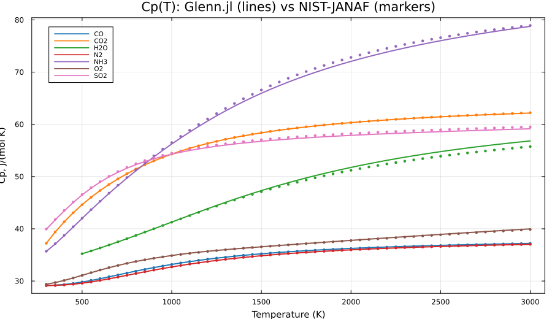
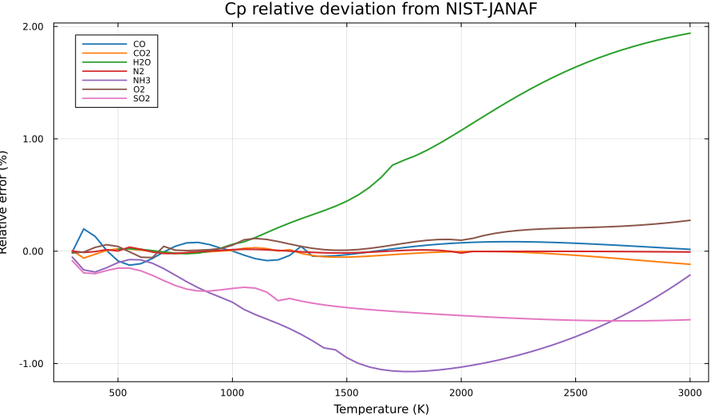
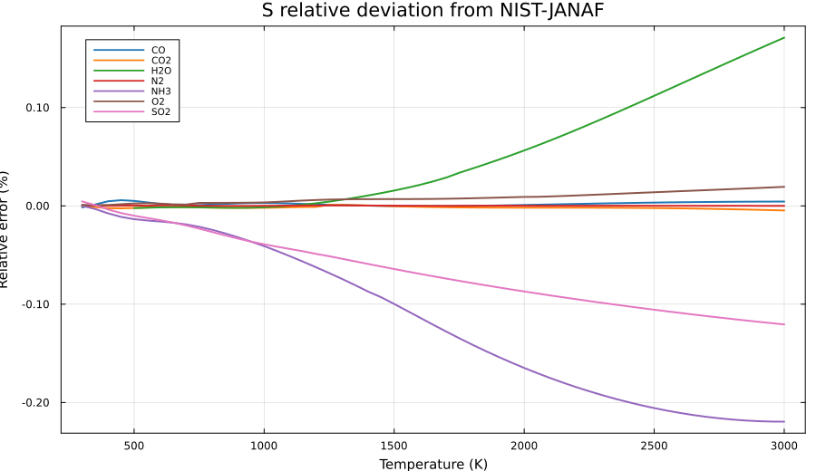

# Validation against NIST-JANAF

Glenn.jl does not merely re-evaluate its own coefficients — it is compared
against an independent reference dataset. `docs/audit/audit.jl` computes
Cp(T), H°(T) and S°(T) with the bundled NASA-7 database and compares them, on a
common temperature grid, with values recomputed from the Shomate coefficients of
the NIST-JANAF Thermochemical Tables (Chase, 1998).

This page summarises the result. The raw numbers are regenerated by running the
script; nothing here is typed by hand.

## What is compared

| Item | Value |
|---|---|
| Species | CO, CO₂, H₂O(g), N₂, NH₃, O₂, SO₂ |
| Temperature grid | 300 – 3000 K, 55 points |
| Glenn.jl side | bundled `thermo.db`, NASA-7 polynomials |
| Reference side | NIST-JANAF Shomate coefficients (SRD 69) |
| Quantities | Cp, ΔH°(298.15 → T), S° |

Two caveats belong with the numbers:

* **CH₄ is excluded.** The NASA-7 coefficients of methane carry a systematic Cp
  bias above 5% relative to NIST-JANAF in part of its range. That is a property
  of the source dataset, not of the evaluation code, so including it would make
  the comparison measure the dataset instead of the implementation.
* **ΔH is the hardest quantity to compare.** The relative error of an enthalpy
  difference diverges mathematically as ΔH°(298.15 → T) approaches zero, so the
  maximum relative error is dominated by a few points near room temperature.
  RMSE and the mean are the meaningful columns; see the note under the table.

## Cp(T): agreement

Lines are Glenn.jl, markers are NIST-JANAF. For most species the two are
indistinguishable at this scale.



## Cp relative deviation



## S° relative deviation



## Summary

Relative errors in percent. Lower is better; the rightmost column is the
relevant one for enthalpies.

| Species | Cp mean | Cp max abs | Cp RMSE | ΔH RMSE | S° RMSE |
|---|---:|---:|---:|---:|---:|
| CO | +0.025 | 0.199 | 0.067 | 2.676 | 0.003 |
| CO₂ | −0.025 | 0.116 | 0.042 | 3.141 | 0.002 |
| H₂O(g) | +0.845 | 1.940 | 1.094 | 0.422 | 0.077 |
| N₂ | −0.001 | 0.037 | 0.011 | 0.007 | 0.000 |
| NH₃ | −0.631 | 1.071 | 0.715 | 8.507 | 0.140 |
| O₂ | +0.101 | 0.275 | 0.136 | 0.084 | 0.010 |
| SO₂ | −0.463 | 0.620 | 0.490 | 6.213 | 0.077 |

Reading the table:

* **Cp and S° agree to within 1.1% RMSE for every species.** S° is consistently
  the best-behaved quantity, under 0.15% everywhere.
* **N₂ is the closest match overall**, below 0.02% RMSE in all three properties —
  as expected, since nitrogen has the smoothest Cp curve of the set.
* **H₂O has the largest Cp deviation** (1.09% RMSE, 1.94% maximum), driven by the
  curvature of its Cp near 1000 K, where the two-interval NASA-7 fit is stiffer
  than the Shomate form.
* **The large ΔH maxima are an artefact of the metric**, not of the code: the
  relative error of a difference that passes through zero near 298 K is
  unbounded. The 62.9% maximum for NH₃ occurs at the first grid point, where
  ΔH°(298.15 → 300) is a few hundred J/mol.

## What this does *not* validate

The comparison checks the **evaluation** of the polynomials and the **plumbing**
that selects intervals, not the accuracy of the NASA-7 fit itself. When Glenn.jl
and NIST-JANAF disagree, the difference is the difference between two fittings of
the same underlying measurements — NASA-7 (seven terms, up to T⁴) and Shomate
(five terms plus an inverse-square term). Neither is "the truth"; NIST-JANAF is
merely an independent implementation with a different functional form.

If you need to know whether a *specific* species is accurate enough for your
application, compare against your own reference data rather than relying on this
table.

## Reproducing

```bash
julia --project=docs docs/audit/audit.jl
```

The script writes, next to itself:

| File | Contents |
|---|---|
| `glenn_vs_nist.csv` | one row per species and temperature, with absolute and relative errors |
| `validation_summary.txt` | per-species aggregated statistics |
| `../src/assets/audit/*.svg` | the three figures on this page |

Plots are optional. Run the script with the root project instead of
`--project=docs` and the CSV and text summary are still produced; only the
figures are skipped, with a warning.
